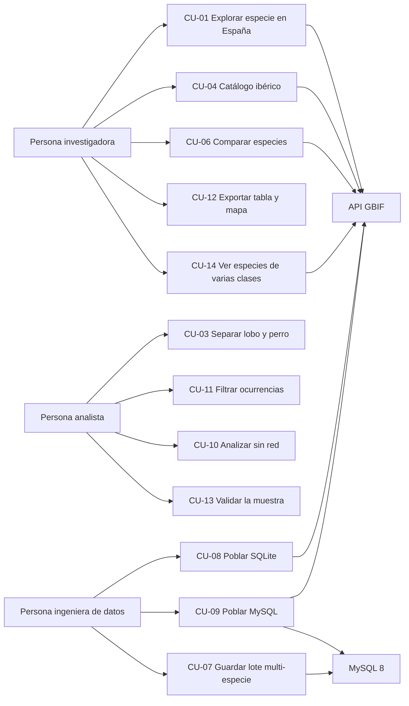
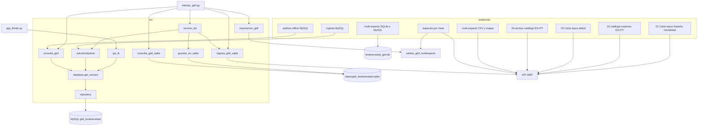
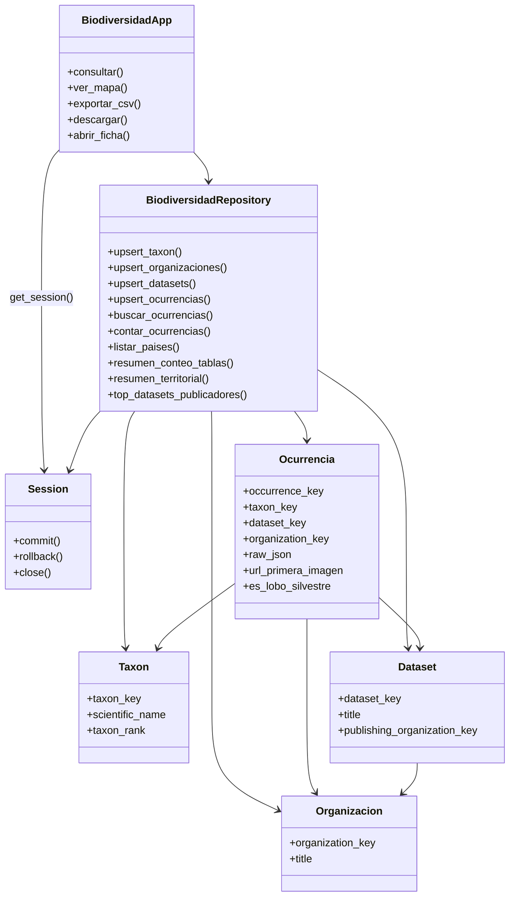
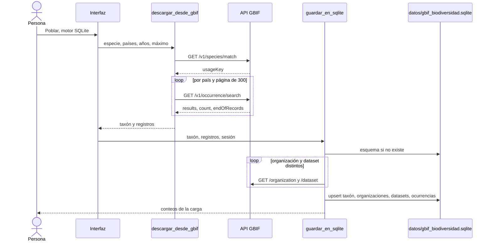
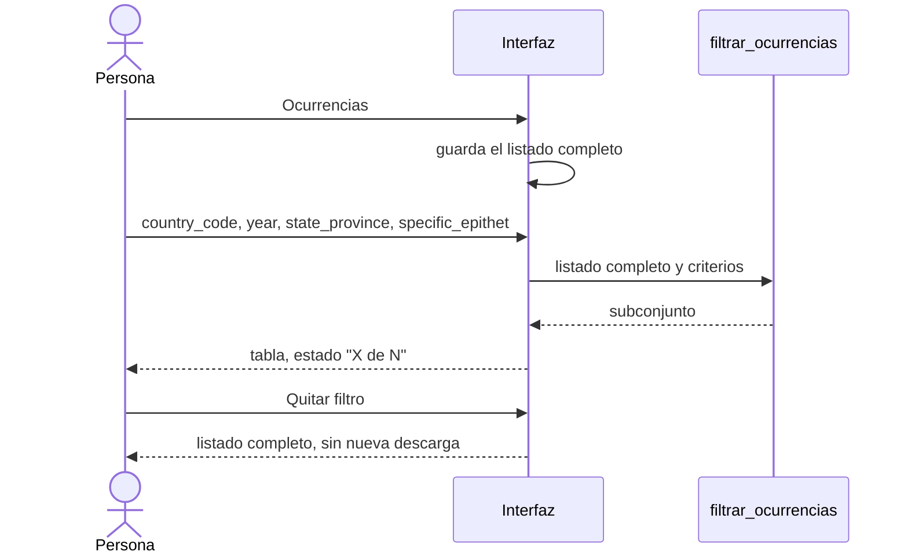
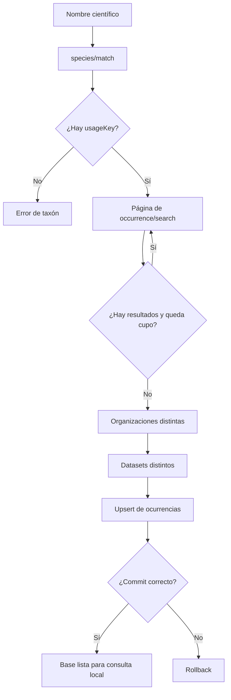
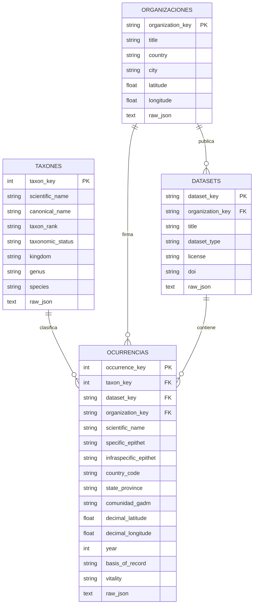
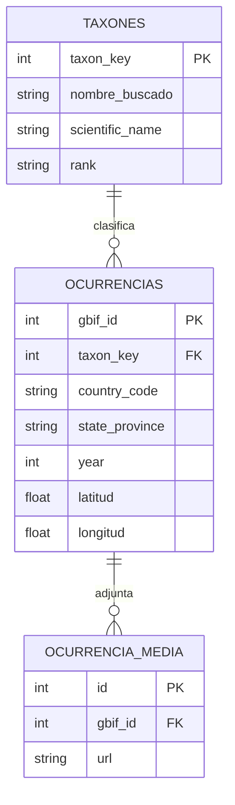

# Diagramas UML

Los diagramas describen el sistema tal como está en `app_tkinter.py`, `interfaz_gbif.py`, `src/` y `notebooks/`. MySQL se lee y se escribe con las entidades de `models.py` y `BiodiversidadRepository`. SQLite sigue en funciones y `DataFrame`. Los requisitos y los casos de uso están en [ESPECIFICACION_REQUISITOS.md](./ESPECIFICACION_REQUISITOS.md) y [CASOS_DE_USO.md](./CASOS_DE_USO.md).

## 1. Casos de uso

## 2. Componentes

## 3. Clases y módulos de la interfaz

`interfaz_gbif.py` trabaja con `DataFrame` y con las funciones de cada módulo. El modelo persistente de MySQL está en la sección 3.1.

`Consulta` está implementada dos veces, con el mismo contrato: `consulta_gbif_sqlite.py` (SQL sobre SQLite) y `consulta_gbif.py` (fachada que abre `get_session` y delega en el repositorio).

## 3.1. ORM de MySQL

`app_tkinter.py` llama a `lanzar_gui()`. La ventana y los cuadernos de MySQL comparten sesión y repositorio.

`taxon_key`, `dataset_key` y `organization_key` de `Ocurrencia` admiten nulo. Si el registro cita una clave que no está en el catálogo, el repositorio la vacía y la ocurrencia se guarda.

## 4. Secuencia: poblar SQLite desde la interfaz

## 5. Secuencia: filtrar ocurrencias ya cargadas

## 6. Actividad de la ingesta

## 7. Modelo entidad-relación del pipeline `src/`

Es el esquema de `docs/schema_gbif_sqlite.sql` y de `docs/schema_gbif.sql`.

## 8. Modelo del cuaderno multi-especie con base de datos

Solo lo crea `gbif_multiespecie_es_pt_sqlite_mysql.ipynb`. No tiene organizaciones ni datasets del Registry. La multimedia va en una tabla propia.

La vista `vw_ocurrencias_completas` une taxón, ocurrencia y multimedia para no repetir esos join en cada consulta del cuaderno.
