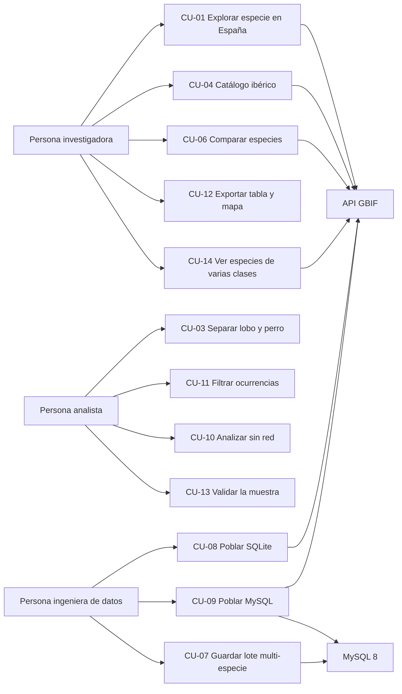
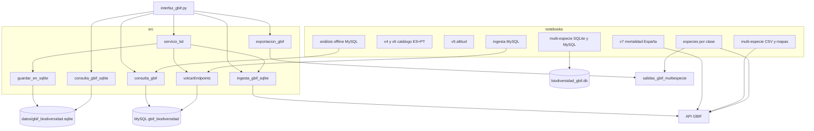
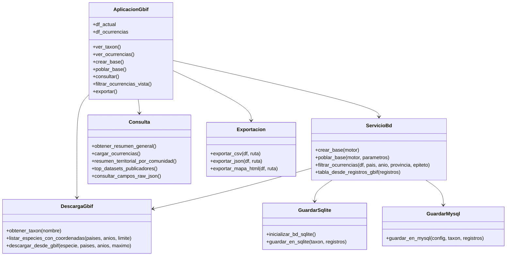
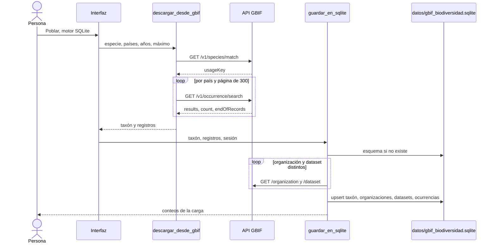
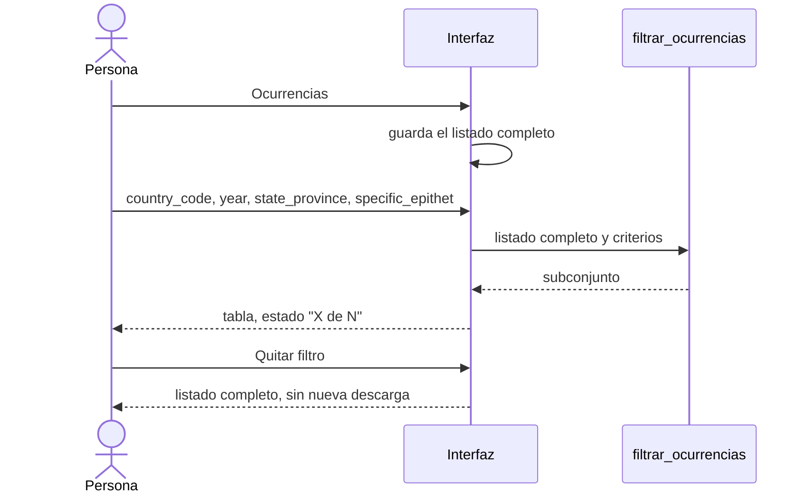
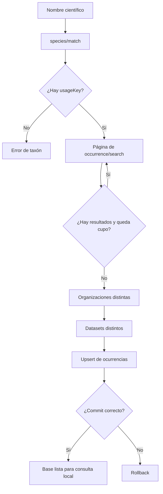
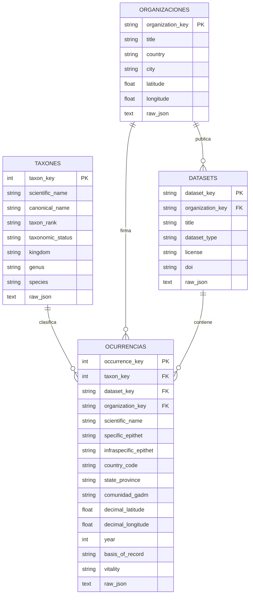
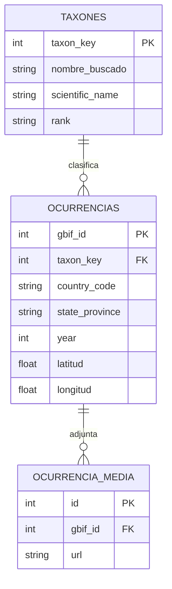

# Diagramas UML

Los diagramas describen el sistema tal como está en `interfaz_gbif.py` (raíz), `src/` y `notebooks/`. Los requisitos y los casos de uso que aparecen aquí están detallados en [ESPECIFICACION_REQUISITOS.md](./ESPECIFICACION_REQUISITOS.md) y [CASOS_DE_USO.md](./CASOS_DE_USO.md).

## 1. Casos de uso

## 2. Componentes

## 3. Clases y módulos de la interfaz

No hay un modelo de dominio con clases persistentes. La unidad de trabajo es el `DataFrame` y las funciones de cada módulo.

`Consulta` está implementada dos veces, con el mismo contrato: `consulta_gbif_sqlite.py` y `consulta_gbif.py`.

## 4. Secuencia: poblar SQLite desde la interfaz

## 5. Secuencia: filtrar ocurrencias ya cargadas

## 6. Actividad de la ingesta

## 7. Modelo entidad-relación del pipeline `src/`

Es el esquema de `docs/schema_gbif_sqlite.sql` y de `docs/schema_gbif.sql`.

## 8. Modelo del cuaderno multi-especie con base de datos

Solo lo crea `gbif_multiespecie_es_pt_sqlite_mysql.ipynb`. No tiene organizaciones ni datasets del Registry. La multimedia va en una tabla propia.

La vista `vw_ocurrencias_completas` une taxón, ocurrencia y multimedia para no repetir esos join en cada consulta del cuaderno.
